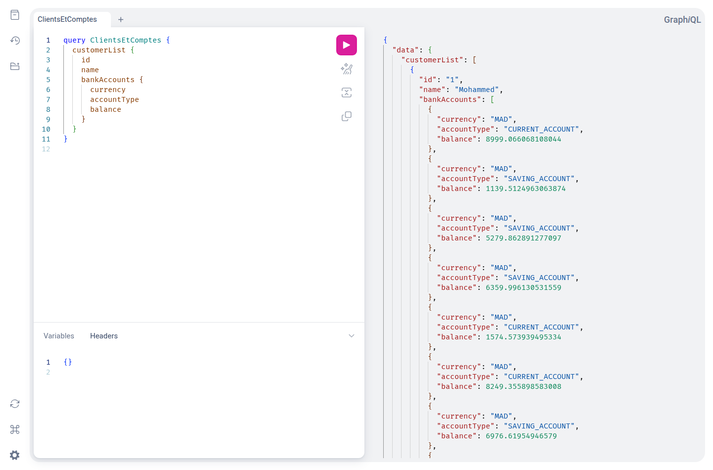
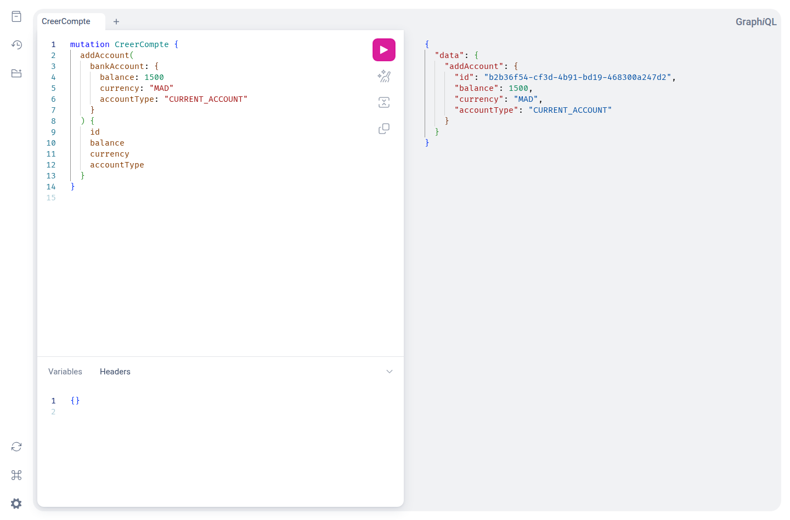
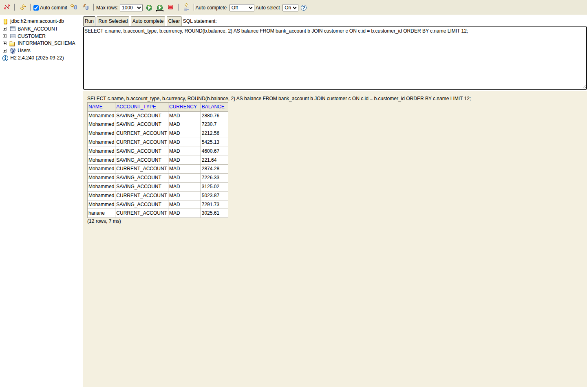

# Bank Account Service

Service de gestion de comptes bancaires et de clients développé avec **Java 21** et **Spring Boot 4.1.1**. Le projet propose une API REST, une API GraphQL et une base H2 en mémoire.

## Fonctionnalités

- Consultation, création et modification de comptes bancaires.
- Suppression de comptes via l’API REST.
- Consultation des clients et de leurs comptes via GraphQL.
- Exploration des ressources avec Spring Data REST et la projection `p1`.
- Exécution de requêtes dans GraphiQL et consultation des tables dans la console H2.

Les comptes possèdent un identifiant UUID, une date de création, un solde, une devise et un type : `CURRENT_ACCOUNT` ou `SAVING_ACCOUNT`. Chaque compte peut être rattaché à un client.

## Technologies

| Technologie | Utilisation |
| --- | --- |
| Java 21 / Spring Boot 4.1.1 | Application et serveur HTTP |
| Spring Web MVC | Contrôleur REST |
| Spring for GraphQL | Requêtes et mutations GraphQL |
| Spring Data JPA / Hibernate | Persistance des entités |
| Spring Data REST | Exposition des repositories |
| H2 | Base de données en mémoire |
| Lombok | Génération des accesseurs, constructeurs et builders |
| Maven Wrapper | Compilation, lancement et tests |

## Démarrage

Prérequis : **JDK 21**, un terminal et un accès Internet au premier lancement pour télécharger Maven et les dépendances.

Depuis la racine du projet :

```bash
./mvnw spring-boot:run
```

Sous Windows :

```powershell
.\mvnw.cmd spring-boot:run
```

Avec Maven déjà installé, `mvn spring-boot:run` convient également. L’application écoute par défaut sur le port **8080**. Pour utiliser un autre port :

```bash
./mvnw spring-boot:run -Dspring-boot.run.arguments=--server.port=8090
```

Au démarrage, l’application crée **4 clients et 44 comptes** en MAD (11 comptes par client). Les identifiants, les soldes et les types de comptes sont générés à chaque lancement. Les données H2 sont perdues à l’arrêt de l’application.

| Interface | Adresse par défaut |
| --- | --- |
| API REST | <http://localhost:8080/api/bankAccounts> |
| GraphQL (HTTP POST) | <http://localhost:8080/graphql> |
| GraphiQL | <http://localhost:8080/graphiql> |
| Console H2 | <http://localhost:8080/h2-console> |
| Ressources Spring Data REST | <http://localhost:8080/bankAccounts> |

## Captures d’écran

Captures réalisées sur une instance locale du projet. Les données affichées peuvent différer à chaque démarrage.

### Clients et comptes dans GraphiQL

La requête sélectionne les clients et les informations de leurs comptes ; la réponse JSON apparaît dans le panneau de droite.



### Création d’un compte avec GraphQL

La mutation renvoie l’identifiant et les informations du compte créé.



### Consultation des données dans H2

La console permet d’exécuter du SQL sur les tables `CUSTOMER` et `BANK_ACCOUNT`.



## API REST

| Méthode | Route | Action |
| --- | --- | --- |
| `GET` | `/api/bankAccounts` | Lister les comptes |
| `GET` | `/api/bankAccounts/{id}` | Consulter un compte |
| `POST` | `/api/bankAccounts` | Créer un compte |
| `PUT` | `/api/bankAccounts/{id}` | Modifier un compte |
| `DELETE` | `/api/bankAccounts/{id}` | Supprimer un compte |

Créer un compte :

```bash
curl -X POST http://localhost:8080/api/bankAccounts \
  -H 'Content-Type: application/json' \
  -d '{"balance":1500,"currency":"MAD","accountType":"CURRENT_ACCOUNT"}'
```

Modifier son solde (remplacer `ID_DU_COMPTE` par l’identifiant reçu) :

```bash
curl -X PUT http://localhost:8080/api/bankAccounts/ID_DU_COMPTE \
  -H 'Content-Type: application/json' \
  -d '{"balance":2000}'
```

Supprimer un compte :

```bash
curl -X DELETE http://localhost:8080/api/bankAccounts/ID_DU_COMPTE
```

Spring Data REST expose également la recherche par type et la projection `p1` (identifiant et type) :

```text
GET /bankAccounts/search/byType?t=CURRENT_ACCOUNT
GET /bankAccounts?projection=p1
```

## API GraphQL

Ouvrir GraphiQL, saisir une opération puis cliquer sur le bouton d’exécution ou utiliser **Ctrl + Entrée**.

### Lister les clients et leurs comptes

```graphql
query ClientsEtComptes {
  customerList {
    id
    name
    bankAccounts {
      currency
      accountType
      balance
    }
  }
}
```

Les requêtes `accountsList` et `bankAccountById(id: "ID_DU_COMPTE")` permettent également de consulter directement les comptes.

### Créer un compte

```graphql
mutation CreerCompte {
  addAccount(bankAccount: {
    balance: 1500
    currency: "MAD"
    accountType: "CURRENT_ACCOUNT"
  }) {
    id
    balance
    currency
    accountType
  }
}
```

### Modifier un compte

```graphql
mutation ModifierCompte {
  updateAccount(
    id: "ID_DU_COMPTE"
    bankAccount: { balance: 2000 }
  ) {
    id
    balance
    currency
  }
}
```

**Limite actuelle :** le schéma déclare `deleteAccount`, mais le contrôleur utilise une méthode `delete` sans préciser le nom du mapping. La suppression GraphQL nécessite d’aligner ces noms ; utiliser la route REST de suppression en attendant.

## Console H2

Ouvrir <http://localhost:8080/h2-console> et utiliser :

| Paramètre | Valeur |
| --- | --- |
| Driver Class | `org.h2.Driver` |
| JDBC URL | `jdbc:h2:mem:account-db` |
| User Name | `sa` |
| Password | Laisser vide |

Exemple de consultation :

```sql
SELECT c.name, b.account_type, b.currency, ROUND(b.balance, 2) AS balance
FROM bank_account b
JOIN customer c ON c.id = b.customer_id
ORDER BY c.name
LIMIT 12;
```

## Organisation du projet

```text
src/main/java/com/example/bankaccountservice/
├── dtos/          # Objets de requête et de réponse
├── entities/      # BankAccount, Customer et projection
├── enums/         # Types de comptes
├── exceptions/    # Résolution des erreurs GraphQL
├── mappers/       # Conversion entité → DTO
├── repositories/  # Accès aux données
├── service/       # Logique de création et de modification
└── web/           # Contrôleurs REST et GraphQL
src/main/resources/
├── application.properties
└── graphql/schema.graphqls
```

## Tests et compilation

```bash
./mvnw test
./mvnw clean package
java -jar target/bank-account-service-0.0.1-SNAPSHOT.jar
```

Le test existant vérifie le chargement du contexte Spring Boot.
